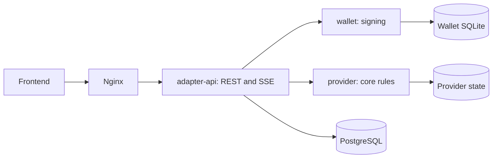

# Digesta backend

A marketplace backend for clients, coordinators and workers to plan projects,
reserve team capacity, deliver milestones and settle payments. Deployments can
choose DAO branding, currency display and terminology through `GET /api/platform`;
the bundled profile is Abako for software projects.

Local development needs no parachain network. The default provider uses Rust rules;
the embedded contract provider runs the same canonical ink! v5 contracts in one
runtime. Both use simulated assets and real signatures. Neither submits transactions
to Kreivo. See [current capabilities and limits](docs/status.md).

## Run

Use Linux, Docker Compose 2.24.4 or newer, and a running Docker daemon. Images build
their own toolchains. Follow the [Compose startup steps](infra/README.md#start) to
generate private development secrets and start PostgreSQL, the backend and frontend.
Open **http://localhost:8088**. The guide covers login, persistent data and shutdown.

[Development accounts and seeding](docs/operations/local-development.md#local-development-accounts)
provide disposable clients, coordinators and workers.
[Walk through the marketplace](docs/marketplace.md) for the complete workflow.
Keep existing state and secrets when updating an environment; see
[environment compatibility](docs/project/digesta-rename.md).

## How it fits together



The adapter owns identity, content, task progress and notifications. The wallet
owns keys. The provider owns enforceable facts: permissions, exact money, capacity,
lifecycle, task IDs and assignees. Services use private HTTP interfaces and own
their stores. Frontends only use the adapter. Read [the architecture](docs/architecture.md)
for transaction, content, notification and recovery boundaries.

| Path | What to read |
|---|---|
| `services/adapter-api/` | Public API, identity, content and operation reconciliation |
| `services/wallet/` | Custodial keys and durable signing jobs |
| `services/mock-provider/` | Native business engine and storage; also the reference for contract parity |
| `crates/provider-execution/` | Shared signature, nonce, replay and receipt shell |
| `crates/generated-contracts/`, `crates/domain-primitives/` | Wire contracts and validated value types |
| `tools/ink-sandbox/` | Isolated contract runtime, pinned WASM and parity tests |
| `apps/leptos-web/` | Independent example frontend |
| `crates/bloque-rs/` | Standalone unofficial Bloque client; not an active backend integration |
| `infra/` | Compose, images, gateway and preview deployment tooling |

The [contract-provider guide](tools/ink-sandbox/README.md) explains how to build,
run and verify WASM execution. Its [canonical source](https://github.com/abako-dev/contracts/tree/review/ink-v5-runtime)
contains Directory, Calendar and Project. The SDK remains isolated from normal
application builds while its promotion gates are open.

## Integrate a frontend

- [HTTP contract and examples](crates/generated-contracts/API.md)
- [OpenAPI](contracts/openapi.json), also served at `/api/openapi.json`
- [DAO profile configuration](services/adapter-api/README.md#public-platform-profile)
- [External frontend setup](infra/README.md#another-frontend)

Sessions use an HttpOnly cookie. Authenticated mutations require `X-CSRF-Token`;
retryable operations use `Idempotency-Key`. Business writes return an operation
reference. Poll it and require exactly one confirmed result, `receipt` or
`taskResult`, before showing completion. SSE notifications do not mark themselves
read. Wallet and provider endpoints are internal.

## Verify and review

For native development use Rust **1.96.1**, Python 3 and PostgreSQL server tools
`initdb`, `pg_ctl` and `psql` on `PATH`, then run as a non-root user:

```sh
bash scripts/install-dev-tools.sh
bash scripts/verify.sh app
```

This runs Rust checks/tests, frontend WASM verification and real-service API E2E
against disposable PostgreSQL. The [verification guide](ci/README.md) also covers
contract parity, dependency policy, containers and browser limits. Use on-disk
`TMPDIR` and Cargo output directories when `/tmp` is RAM-backed.

[Approved requirements](specs/README.md) define business behavior.
[Contributing](CONTRIBUTING.md) describes changes and review.
[Recovery](docs/operations/disaster-recovery.md) and [security findings](docs/security/supply-chain.md) cover operational limits.
Record commands, results and tested revisions in PRs; historical development notes
remain in Git. Release publication and deployment require explicit approval.
