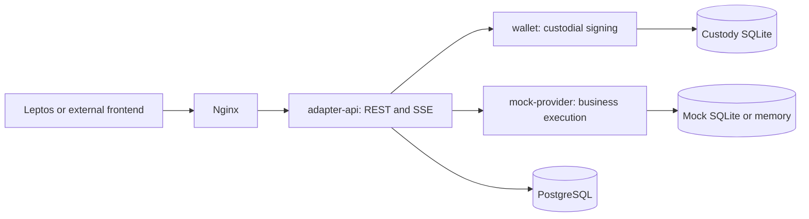

# Digesta backend

Digesta is a marketplace for clients, coordinators and workers to plan projects,
reserve team capacity, deliver milestones and settle payments. This Rust backend
provides a REST API, custodial signing and a lightweight simulated provider so
application development does not require a local parachain network.

The current implementation supports profiles, skill matching and calendars,
proposals, milestone escrow and payouts, final evaluations, notifications and
public dispute opening with a private case conversation. `GET /api/platform`
provides deployment-specific DAO branding and terminology; the bundled profile
is Abako for software projects.

**Funds and contract execution are simulated.** The mock verifies real sr25519
signatures and uses Rust business logic by default. The explicit
[ink! v5 provider candidate](tools/ink-sandbox/README.md) runs source-pinned
Directory, Calendar and Project WASM locally, with Shadow comparison and
current-state migration/rollback. Neither provider submits transactions to
Kreivo or uses real funds. Existing data needs the paired
[current ownership transition](specs/0015-adapter-core-boundary/r2b-proposals.md). See the
[current status and limitations](docs/project/project-context.md).

## Architecture



Only the adapter is exposed through the API gateway. The wallet owns signing
keys; the provider owns enforceable business facts. The adapter owns profiles,
immutable creation text and other application content. Contract instances are objects
inside one atomic mock runtime, rather than separate nodes or services.
See [data ownership](docs/architecture/data-ownership.md) and the
[architecture decision](docs/architecture/adr/0001-rest-and-independent-frontends.md).

## Run locally

Use Linux, Rust **1.96.1**, Python 3, Docker Compose **2.24.4 or newer** and a
running Docker daemon. Backend and browser images build their own toolchains.
No agent tooling or blockchain nodes are needed.

Follow the [local Compose startup guide](infra/README.md#start), which generates
private development secrets and starts PostgreSQL, the backend and the independent
Leptos frontend. Open **http://localhost:8088**. The guide explains administrator
login, persistent data, shutdown and replacing Leptos with the team's frontend.
For an existing environment, read the [rename notes](docs/project/digesta-rename.md)
before changing any secrets or storage.

[Local development accounts and seeding](docs/operations/local-development.md#local-development-accounts)
provide disposable workers, coordinators and clients for the complete flow.
The [happy-path guide](docs/project/happy-path.md) explains the workflow and API calls.

## API and frontend integration

Both frontends use the same public REST/JSON and authenticated SSE API:

- [HTTP contract and examples](crates/generated-contracts/API.md)
- [OpenAPI](contracts/openapi.json), also served at `/api/openapi.json`
- [Platform profile configuration](services/adapter-api/README.md#public-platform-profile)
- [External frontend setup](infra/README.md#another-frontend)

Sessions use an HttpOnly cookie. Authenticated mutations need `X-CSRF-Token`;
retryable operations use `Idempotency-Key`. Business mutations return
`202 OperationRef`: poll the operation and inspect its execution receipt before
showing success. SSE delivery does not mark notifications read. Wallet and
provider endpoints are internal.

## Verify

For application verification without containers, install PostgreSQL server tools `initdb`,
`pg_ctl` and `psql` on `PATH`, then run as a non-root user:

```sh
bash scripts/install-dev-tools.sh
bash scripts/verify.sh app
```

The command runs Rust checks, tests, the frontend WASM check and API E2E.
The E2E suite starts disposable PostgreSQL and real backend processes with fresh
secrets. It runs four scenarios on each mock storage backend: the signed
lifecycle/security/SSE flow, a four-milestone team flow, disputes and auxiliary
profile/catalog/Bramp checks. It removes temporary data. These are API tests;
browser behavior needs a separate check.

See [verification and CI](ci/README.md) for Rust, frontend, infrastructure and
dependency-policy checks. Historical results describe the revisions they tested.

## Repository guide

| Path | Contents |
|---|---|
| `services/` | REST adapter, signing wallet and transactional mock provider |
| `crates/` | Domain primitives, wire contracts and standalone Bloque client |
| `apps/leptos-web/` | Independent browser frontend consuming the public API |
| `contracts/` | Public OpenAPI and contract governance |
| `tools/ink-sandbox/` | Isolated v5 WASM compatibility proof and pinned artifacts |
| `infra/` | Local Compose, images, gateway and server-preview tooling |
| `specs/` | Approved behavior; see the [specification index](SPECS.md) |
| `docs/` | Architecture, development, operations and security guidance |

Start with [current status](docs/project/project-context.md),
[requirements](SPECS.md), [deployment and recovery](docs/operations/cloud.md),
[contributing](CONTRIBUTING.md), and the [approved simplification plan](docs/project/repository-simplification.md).
The server preview uses simulated assets; production custody and real-chain
execution are not delivered. Releases and deployments require explicit approval.
