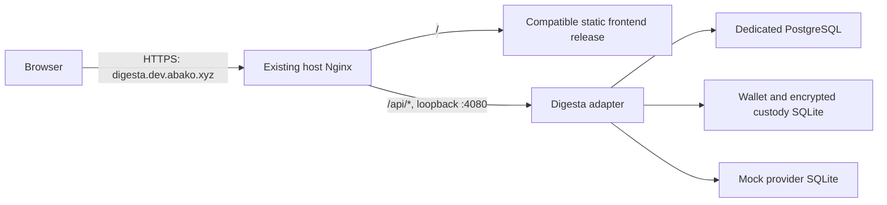

# Digesta server deployment proposal

Historical server proposal. For the selected hostname and current operating
procedure, use [cloud status](cloud.md) and the
[preview guide](digesta-backend-preview.md).

Status: DRAFT

Task: DEPLOY-DISCOVERY-001

Observed: 2026-10-15, over the user-selected `digesta` SSH alias.

Requested rollout: Run Digesta alongside the existing stack, then switch traffic.

## Recommendation

Use the existing Docker Compose and host Nginx installation. Create an isolated
`digesta-preview` Compose project with adapter, wallet, mock provider and its own
PostgreSQL instance. Publish only the adapter on `127.0.0.1:4080`, behind a new
HTTPS Nginx site at `digesta.dev.abako.xyz`.

Serve a frontend that implements Digesta's REST/session/CSRF contract on the same
origin. Keep the current Abako sites and containers running during validation.
The user requested a `digesta.*` subdomain; `digesta.dev.abako.xyz` extends the
existing development domain without changing its current routes.

Compose supports a single-server deployment and an environment-specific override
for images, ports, settings and restart policies. This follows the server's
existing operating model. [Docker documentation](https://docs.docker.com/compose/how-tos/production/).

Scope: mock-backed development deployment. Production custody and legacy data
migration need their own approved specifications under the repository's
[deployment policy](cloud.md).

## Observed host and services

| Item | Observation |
|---|---|
| SSH | `digesta`, root login, `128.140.7.148:22`; security-key touch required |
| OS and architecture | Ubuntu 24.04.3 LTS; x86-64 |
| Resources | 8 logical CPUs; 15 GiB RAM, about 13 GiB available; 147 GiB free disk |
| Container tooling | Docker 29.0.2; Compose 2.40.3; Podman 4.9.3 |
| Proxy | Host Nginx 1.24.0; HTTP/HTTPS on ports 80/443 |
| Boot services | Docker, Nginx and Certbot timer enabled |
| Firewall | UFW active; SSH, HTTP and HTTPS allowed |
| Old backend | `abako-dev` Node services on loopback 3000, 3001, 3010, 4000; PostgreSQL 16 on loopback 5432 |
| Old stack source | `/opt/abako/dev/repo/infrastructure/docker-compose.yml` |
| Old persistent data | `abako-dev_postgres-data`, `abako-dev_virto-api-data` |
| Public frontend | `/opt/abako/web-dev/current` -> `/opt/abako/web-dev/releases/f4b1ec5` |
| Additional frontend service | `website-frontend.service`, root user, port 5173; its source is `/opt/website/website/frontend` |
| Existing TLS | `dev.abako.xyz` and `web.dev.abako.xyz`, with Certbot renewal scheduling |
| Candidate DNS | `digesta.dev.abako.xyz` does not currently resolve |
| Host maintenance | `/var/run/reboot-required` exists; schedule maintenance separately from the application rollout |

Available resources suggest room for a small parallel preview; this is a host
snapshot, not load-test evidence. No app-specific backup was identified in the
inspected timers and cron job names; external or provider backups were not checked.

## Release artifacts

`v0.2.0` points to `bdbbaa8e770f83b9a636f6fec75b130d8f713e54`.
[Release run 38712832177](https://github.com/abako-project/backend-v2/actions/runs/38712832177)
passed formatting, Clippy, Nextest including PostgreSQL tests, doc tests and all
three image publications.

The following `0.2.0` manifests were independently fetched anonymously from
GHCR. Each includes a `linux/amd64` image, compatible with this host.

| Image | Manifest digest |
|---|---|
| `ghcr.io/abako-project/digesta-adapter-api` | `sha256:c121368e5d11061be93e466ec2483046b4270cf61b8b456640f3c664ae4e7dd2` |
| `ghcr.io/abako-project/digesta-wallet` | `sha256:88a41ae8c369b1e96e26f2daf3c8aa769bf1795efa493c17bdc8a1dd6f0aa5ef` |
| `ghcr.io/abako-project/digesta-mock-provider` | `sha256:68b0c1a7199ef159031508b90f33bae5af27c4c3afe15d61210e16bdaeeb5bc6` |

Pin these digests in the deployment configuration. Anonymous manifest access
works, so no GHCR login is needed for these artifacts. GitHub documents anonymous
access for public container images and pulling by digest.
[GHCR documentation](https://docs.github.com/en/packages/working-with-a-github-packages-registry/working-with-the-container-registry).

## Candidate layout

Use `/opt/digesta/preview` for deployment configuration and frontend releases;
keep application state under `/srv/digesta/preview`. Give application processes
a dedicated non-root host UID/GID and matching custody/mock bind directories.
Keep secrets in a mode-0700 directory with mode-0600 files. PostgreSQL should
retain its image-supported ownership and a separate `digesta-preview` volume.

Adapter connects to both a normal bridge network and an internal backend network.
PostgreSQL, wallet and mock use only the internal network and have no host ports.
Retain the application's read-only filesystem, capability restrictions, bounded
temporary mounts and service-specific secret access.

## Rollout

1. **Prepare an isolated candidate.** Create a server-specific Compose definition
   based on the existing four backend/database services. Use the three published
   digests, remove local build directives, add restart policies and health checks,
   and expose adapter `8080` only as loopback `4080`. The repository's gateway and
   Leptos container are optional frontend arrangements; the host already has Nginx.
2. **Provision coherent state.** Generate a new complete secret set with the
   published wallet's `init-dev-secrets` command under the chosen UID/GID. Give
   PostgreSQL its own non-default credentials. Keep the new database, custody and
   mock stores together. Do not point this stack at the old PostgreSQL volume or
   import old records without a migration specification.
3. **Add DNS and TLS.** Point `digesta.dev.abako.xyz` at `128.140.7.148`. Add an
   Nginx virtual host and issue a certificate using the existing Certbot webroot
   arrangement. Confirm DNS before certificate issuance; existing certificates
   are for the existing names. Retain renewal through the current timer.
   [Certbot webroot guidance](https://eff-certbot.readthedocs.io/en/stable/using.html#webroot).
4. **Configure the public contract.** Set `ALLOWED_ORIGINS` and `WEBAUTHN_ORIGIN`
   to `https://digesta.dev.abako.xyz`, `WEBAUTHN_RP_ID` to
   `digesta.dev.abako.xyz`, and `COOKIE_SECURE=true`. Set explicit adapter,
   custody and mock connection settings. Keep the existing authorization and
   service-token checks.
5. **Deploy a compatible frontend.** The currently served bundle calls legacy
   routes such as `/auth/custom-connect`, `/api/attestation` and
   `/adapter/v1/auth/custom-connect`, and contains no `X-CSRF-Token` literal.
   It cannot be connected to the new adapter by changing a URL. Deploy a build
   integrated with the current OpenAPI, or the independent Leptos test frontend
   for initial backend acceptance. Backend release publication does not include
   a frontend artifact.
6. **Route and validate.** In the new Nginx site, proxy `/api/` to loopback 4080
   while retaining the `/api` prefix. Disable proxy buffering/cache for SSE and
   allow its long-lived connections. Forward the original host and HTTPS scheme;
   keep internal and health/readiness routes out of public routing. Serve the
   compatible frontend under `/` on the same origin.
7. **Exercise the preview.** Check container health and restart behavior; login,
   the secure `digesta_session` cookie, CSRF denial/acceptance, allowed origin and
   passkey behavior; then a signed mock operation and SSE disconnect/replay.
   Measure memory and disk use before setting final resource budgets. Prove a
   coherent backup and restore of the new PostgreSQL, custody, mock and secrets.
8. **Switch traffic.** Move users or the selected existing frontend/site to the
   validated Digesta frontend/backend pair. If keeping a different public
   hostname during cutover, update its exact origin and WebAuthn configuration
   together and retest login. Keep the old stack and frontend release available
   through the agreed rollback window.

## Rollback and operations

For the initial preview, rollback means restoring the previous public route or
frontend symlink and leaving the old containers/state intact. Take a separate
coherent backup before switching traffic. Records created in Digesta do not
automatically exist in the old stack; routing rollback must account for those
records before writes are accepted after cutover.

Pin image digests and use deliberate updates. The current repository's automatic
database initialization means image rollback alone does not guarantee schema
rollback. Keep PostgreSQL backup and SQLite/secret recovery plans with the
deployment configuration. Use Docker restart policies, Nginx/Certbot checks,
container health, bounded logs and host disk/availability checks for this preview.

## Remaining decisions and implementation boundary

- Confirm the preview hostname's DNS ownership and create its record.
- Choose the current compatible frontend artifact for acceptance and cutover.
- Decide whether any old application records must migrate; this proposal starts
  with isolated preview state.
- Agree on the traffic switch and rollback window before accepting real users'
  writes into the candidate.

No server configuration, containers, application records, DNS, certificates or
secrets were changed during inspection. This document proposes the next work;
deployment implementation requires its scoped specification and authorization.
